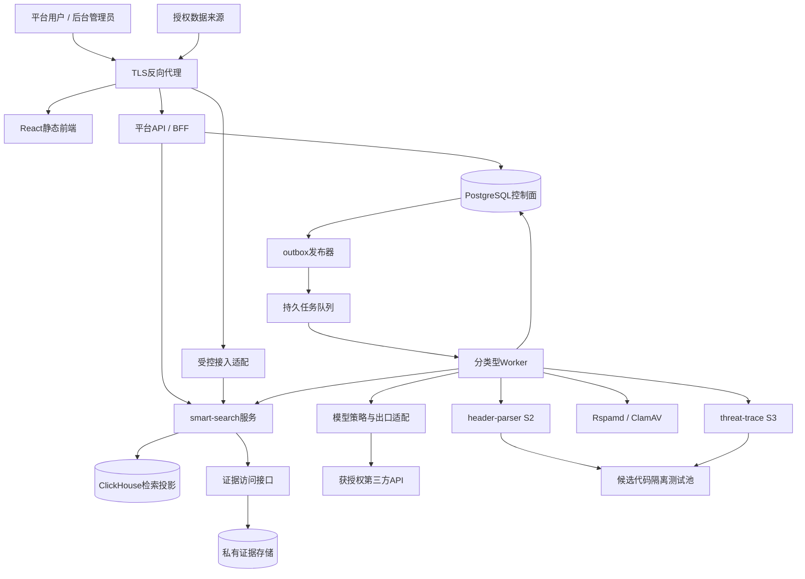
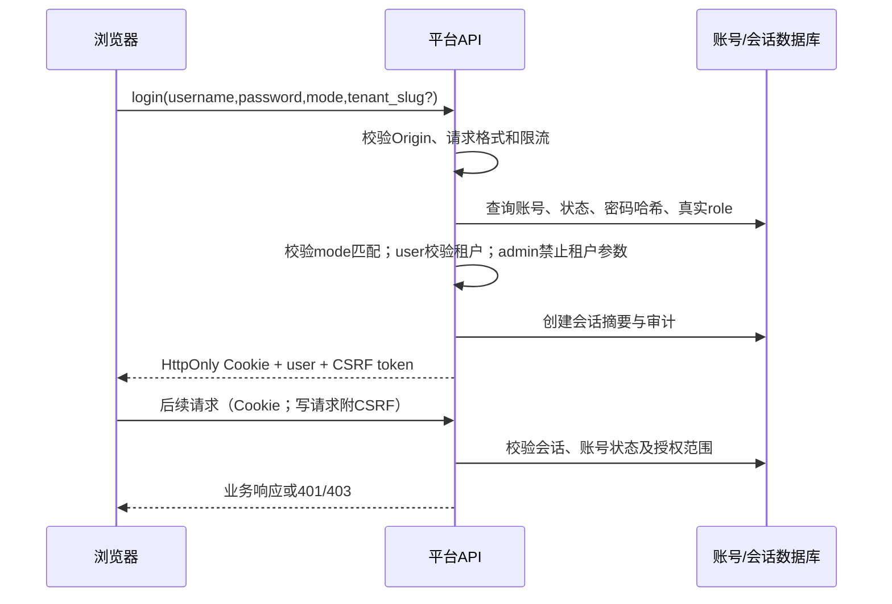
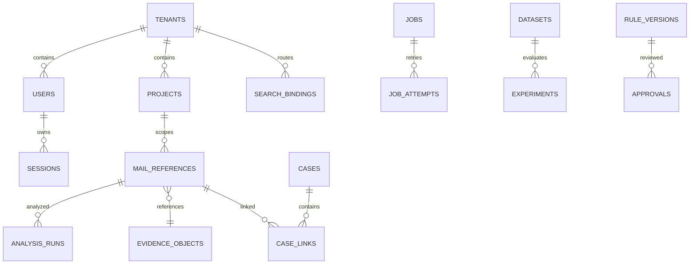

# MailSec Nexus 邮件安全智能分析与溯源平台系统设计文档

> **版本**：v1.0 · **日期**：2026-11-12 · **状态**：系统设计基线，供开发、联调与验收使用。  
> **设计范围**：统一前端、平台后端、smart-search、header-parser、threat-trace及数据、安全、部署设施。  
> **重要说明**：本文区分“当前实现”“目标设计”“上线前冻结项”；不是完整产品已实现或生产验收通过的声明。本次仅生成设计文档，不修改运行服务、数据库或样本。

## 1. 设计依据与范围

### 1.1 依据及冲突处理

- 业务与质量要求：[综合需求分析](综合需求分析.md)。交互身份只有**平台用户user、后台管理员admin**；管理员具有最高平台操作及所有租户业务数据读写权。
- 最新平台事实：[平台说明](../mailsec-platform/README.md)、[API契约](../mailsec-platform/api/API_CONTRACT.md)、[数据库v1](../mailsec-platform/docs/database-v1.md)、[设计源DESIGN.md](../DESIGN.md)。当前首期采用本地账号密码，不能继续将旧文档的OIDC设想写成当前实现。
- 最新邮件接入：[统一输入流标准契约](../mailsec-smart-search/docs/统一输入流交付包/邮件离线分析_统一输入流标准契约规范.md)、[smart-search说明](../mailsec-smart-search/README.md)及对应源码。2026-11的规范扁平JSON/批量输入优先于10月嵌套JSON主入口描述；历史兼容路径保留。
- 旧[架构基线](../mailsec-platform/docs/architecture.md)和[数据/API初设](product/数据与接口设计.md)继续提供目标背景，但其中“平台未实现”“JSON固定34列”“首期OIDC”“来源键仅租户内唯一”等旧描述不得覆盖最新事实。

本文将已核验的最新边界整合为统一设计。后续变更须同步契约、迁移、测试及决策记录；不能用设计文档原地改变已发布接口。

### 1.2 开发与交付边界

顺序固定：**smart-search → header-parser → threat-trace**，平台身份、页面、测试和部署随阶段交付。smart-search始终可独立运行，不依赖后两个模块才能接入和检索。

首版是离线邮件分析与调查产品，不是SMTP转发/实时拦截网关。不自动封禁、不执行任意模型生成代码、不承诺真实攻击者身份。动态附件沙箱及外部处置连接器另立扩展范围。

### 1.3 当前实现与目标差距

| 能力 | 当前代码/文档可确认 | 本文目标设计 |
| --- | --- | --- |
| Web与登录 | React/TypeScript/Vite；本地密码；user/admin模式；普通用户注册后待管理员启用 | 保留现有流程；补齐生产MFA、IAM-01要求的OIDC适配、账号治理及完整业务页面 |
| 身份控制面 | 账号、租户、会话、限流、审计；SQLite开发预览、PG部署定义 | PG正式部署/迁移/权限验证；项目、任务、案件和审批等领域表 |
| 邮件查询 | 平台BFF适配历史EML/JSON；浏览器不持有上游token | 多实例租户路由、项目/用户数据边界；模型、案件与实验前端 |
| 隔离 | 一个专用smart-search实例绑定一个平台租户；未绑定拒绝；同租户用户共享当前实例可见范围 | 普通用户按项目/资源隔离；管理员管理全部已接入租户；共享索引隔离另行验证 |
| 数据接入 | 统一输入流v2，单条/原子批量，SQLite持久队列；JSON表已扩为39列 | 保持契约；增加可信来源授权、完整证据存储和平台任务映射 |
| 算法 | smart-search检测/模型适配代码已有；其他两模块在平台为未接入说明，调用返回501 | 逐阶段实现头部解析、行为规则算法、实验与审核发布 |
| 基础设施 | 平台Compose已有配置；Cloud预览与独立本地栈是不同运行方式 | TLS、生产数据库实测、对象存储、持久消息队列、恢复/HA验证 |

以上为仓库核对，不是本次重新执行测试或检查服务存活的结果。历史报告不自动证明当前完整Compose、真实模型效果或生产隔离通过。

## 2. 总体架构

### 2.1 架构风格与技术选型

采用**前后端分离、模块化控制面、独立领域服务/Worker**。初期不拆大量微服务；高风险或高耗时任务单独执行。平台不复制三模块算法，也不直接修改模块私有业务表。

| 层级 | 设计选型 | 使用边界 |
| --- | --- | --- |
| 前端 | React + TypeScript + Vite，沿用现有组件与设计token | 当前没有Ant Design依赖，不为文档重写UI；深色导航、浅色内容、响应式 |
| 平台API/BFF | FastAPI + Pydantic + SQLAlchemy | 身份、范围校验、任务/案件、管理、审计、领域接口适配 |
| 算法/Worker | Python，沿用已验证模块依赖 | 接入清洗、检测/模型、头部解析、规则回测按队列隔离 |
| 事务数据库 | PostgreSQL；开发预览可SQLite | PG是正式控制面；SQLite测试不等于PG并发/权限已验证 |
| 检索数据库 | ClickHouse，经smart-search访问 | 支持现有Cloud对接或独立自部署；不引入ES DSL |
| 原始证据 | 当前受控文件/审计记录；目标为私有S3兼容对象存储 | 原文、附件、报告、算法产物分区保存；对象产品在部署评审时冻结 |
| 异步任务 | 当前SQLite spool；目标为PG outbox + RabbitMQ + Worker | 扩展阶段迁移，不与旧队列无协调重复消费 |
| 身份 | 首期本地账号+可撤销服务端会话 | OIDC按现行IAM-01的S1/P0保留为待实现企业身份适配；MFA同为生产管理员登录待实现门禁 |
| 部署/观测 | Nginx/TLS、Docker、CI/CD；目标增加统一指标/追踪/告警 | Compose供开发/试点；HA需独立故障域和恢复证据 |

组件精确版本以各lockfile、镜像及兼容报告为准；本文不宣称其为最新或当前安全补丁已齐备。不默认引入Kafka、Redis、向量库、图数据库、GPU或服务网格。

### 2.2 目标逻辑架构

这是目标图。当前接入仍可直接进入独立smart-search及本地spool；对象存储、RabbitMQ和后两模块不因出现在图中而成为已部署服务。

### 2.3 模块职责与接口

| 模块 | 输入 | 输出 | 不承担 |
| --- | --- | --- | --- |
| platform | 用户/管理员操作、模块结果 | 可信身份/作用域、统一页面、任务/案件/审批/审计 | 直接执行邮件分析算法、自由SQL |
| smart-search | 规范JSON、EML、受控查询、分析命令 | 回执/索引、检索统计、检测与融合结果 | 仅凭上游tenantId提供生产租户隔离 |
| header-parser | 有序头、可信接收配置、方言样本 | 版本化路由/认证/伪造/流向证据、解析器产物 | 将自述首跳当真实攻击者；热执行生成代码 |
| threat-trace | 告警、关联邮件、标签与反例 | 行为簇、候选检出算法、回测、规则命中 | 未审核发布到企业现网或自动封禁 |
| 共享工程设施 | 授权引用、任务/状态事件 | 证据访问、队列、模型出口、监控与恢复 | 绕过领域所有权和用户授权 |

## 3. 用户、权限与认证设计

### 3.1 两类账号与操作矩阵

| 操作 | 平台用户user | 后台管理员admin |
| --- | --- | --- |
| 登录 | 用户租户模式，校验账号所属租户 | 管理员模式，不填租户 |
| 邮件/案件/任务/实验 | 所属租户且获授权的资源 | 全平台数据可读写，具体操作显式选择目标范围 |
| 用户/租户/来源/模型配置 | 不允许 | 可创建、管理、停用与调整 |
| 候选算法/规则 | 在授权域内实验、提交候选 | 审核、指定范围启用、停用、回滚 |
| 数据导出/删除 | 提交允许范围的申请 | 审核或直接发起受控操作，记录影响和审计 |
| 更改账号类型/作用域 | 禁止自助提权 | 目标管理动作须专门接口、重新认证及会话撤销；当前普通PATCH不支持此动作 |

管理员最高权限是应用权限，不等于开放数据库超级用户、宿主机命令或任意模型工具。数据保全、证据版本、安全检查和审计仍保留。

### 3.2 登录与注册时序

- 登录页保留“用户登录/管理员登录”两模式，另有普通用户注册入口；**注册不是第三种账号类型**。注册仅建立已有租户下的inactive user，管理员核实并启用后才有登录资格。
- 当前本地密码使用带随机盐的scrypt哈希；会话token仅摘要落库。Cookie使用HttpOnly、SameSite，HTTPS上线启用Secure；密码/停用变更撤销会话。密码更改后的当前会话也失效。
- 初始管理员由受控CLI引导创建，无默认密码、不开放管理员自助注册。账号与tenant slug是标识而非授权证明。
- 当前已选定的本地密码用于现有开发底座；现行综合需求IAM-01仍将OIDC对接列为S1/P0，因此目标验收继续保留OIDC适配，并补齐管理员MFA、登录/注册入口限流及安全恢复流程。OIDC映射至同一user/admin模型，不放松业务授权。本地登录通过不等于该P0全部完成；如企业决定生产仅用本地账号，必须先更新需求/决策记录并确认验收范围，不能由本文自行降级为可选。
- 会话安全设计参考[OWASP Session Management](https://cheatsheetseries.owasp.org/cheatsheets/Session_Management_Cheat_Sheet.html)；具体参数随安全测试和部署配置冻结。

### 3.3 租户与用户隔离：实施路径

**当前安全基线**：只有`SMART_SEARCH_DEDICATED=true`且请求租户与绑定租户一致，平台才可调用上游；实例中的数据必须确实只属于该授权空间。管理员也要传目标租户。当前同租户用户共享可见数据，不能宣称逐用户/项目隔离已完成。

**目标分两步落地**：

1. **多专用实例路由**：新增`search_bindings`，由管理员绑定租户、受控内部endpoint、密钥引用、数据来源声明和状态。BFF从可信租户解析绑定，不能接受用户任意指定上游URL。管理员可查询所有已绑定租户；全局查询拆分有界子查询，任一失败则明确partial，不能漏项后给“完整总数”。
2. **项目/资源授权**：新增projects/memberships/资源归属。领域服务必须在查询、计数、分页、详情、分析及导出前执行授权范围，不能先取全库再在前端过滤。共享索引方案须同时增加受信授权字段、投影同步与撤权测试，通过前保留专用实例拒绝策略。

普通用户的缓存、游标、任务与报告绑定主体/范围/策略版本；管理员跨租户结果使用独立范围键。正文、总数、哈希存在性和错误信息均不可形成越权侧信道。管理员跨租户写入仍保留每个对象的归属，不构造非法跨租户外键。

PG目标采用应用授权与RLS纵深防御，业务/迁移身份分开；表所有者、superuser、BYPASSRLS及TRUNCATE边界需专项处理，不能只启用一项配置就宣称安全。依据：[PostgreSQL 17 RLS](https://www.postgresql.org/docs/17/ddl-rowsecurity.html)。当前v1未据此完成RLS验收。

## 4. 前端系统设计

### 4.1 页面与组件组织

前端沿用[DESIGN.md](../DESIGN.md)及现有React代码，不另外生成与运行代码无关的界面体系。

| 区域 | 页面/交互 | 当前与目标 |
| --- | --- | --- |
| 身份入口 | 登录模式切换、租户输入、注册/待审核提示、退出 | 当前已有；目标补齐MFA/生产恢复交互 |
| 业务工作台 | 总览、历史EML/JSON切换、条件筛选、列表、统计、详情 | 当前已有核心查询；目标补齐NL计划、分析/SOP与任务 |
| 调查流程 | 案件、证据时间线、标签、报告 | 待实现，与查询/分析结果按引用联动 |
| 头部/溯源 | 当前未接入说明；未来证据路由、规则/回测页面 | 当前允许明确说明页及501，不能展示伪分析结果 |
| 管理后台 | 账号、租户、审计；未来全平台数据/来源/模型/配额/发布 | 当前只实现部分管理操作；后台权限覆盖目标不等于所有按钮已完成 |

当前App通过Page状态切换视图，未引入完整URL路由库；未来深链接/刷新恢复须单独实现并验收。

组件按`auth / shell / search / detail / admin / tasks / cases / experiments`划分责任，公共层维护API客户端、状态提示、表单、表格和设计token。这是组织方向，不要求立即重排现有目录。

### 4.2 前端状态与数据规则

- 浏览器仅访问平台API，不持有ClickHouse凭据、模型key或smart-search全局token；Cookie会话与CSRF处理集中在API客户端。
- 模式、租户或数据源切换时清空结果/选择/统计，取消旧请求；迟到响应须与当前请求版本匹配才渲染，避免旧租户结果闪回。
- 查询结果区分loading、empty、forbidden、error、partial与stale；敏感筛选不放URL，不将会话凭据/原文持久写入localStorage。
- 当前使用limit/offset：legacy的total为null、总数单独统计，q仅查正文；JSON与EML字段不硬凑成虚假的风险/发送时间。未来游标分页须新契约或兼容字段，不悄然替换。
- HTML原文当前只按文本展示。附件不自动执行、远程资源不自动加载；新增HTML预览需净化、隔离和CSP验收。
- 1440/1024/768/375px响应式；长表格只在容器滚动，表单可键盘操作。发布使用静态构建而非Vite开发服务器。

## 5. 后端与领域模块设计

### 5.1 平台API内部层次

`HTTP路由/Schema → 身份与授权依赖 → 应用服务 → 仓储/领域适配器`。

- 路由层只做协议转换和输入验证；应用服务处理注册审核、任务提交、状态迁移和管理操作。
- 仓储拥有PG事务；smart-search适配器统一处理event/legacy差异、超时、错误脱敏与绑定检查。
- 对业务异常使用确定错误码；上游不可用明确503，未实现模块501，不自动返回模拟数据。
- 高风险命令将审计与本地业务变化同事务提交；需跨系统执行时保存命令/attempt和结果，不能在远程写成功但审计失败后悄悄丢失轨迹。

### 5.2 smart-search处理单元

| 单元 | 处理与产物 |
| --- | --- |
| Intake/Canonical | 规范JSON单条/数组校验、UUID/来源幂等、字段有界清洗、原子持久接收 |
| Spool/Worker | 持久队列领取、处理、批写、失败/重试及回执查询；done语义与实际落库一致 |
| EML Parser | 有界RFC5322/MIME基础解析、有序头、正文/附件摘要、完整性和异常标签 |
| Repository/Query | 参数化过滤、统计、摘要/详情、查询资源限制；EML与JSON语义分开 |
| NL Plan | 本地敏感实体处理、模型生成白名单过滤器、验证/预览、确定性编译 |
| Detection/Analysis | 规则/签名与模型独立记录，按证据完整性融合，保留人工反馈及版本 |

统一输入流已有字段截断/省略manifest时，必须传递`evidence_quality`，不能在后续头部/AI分析中把缺失部分当不存在风险。

### 5.3 header-parser与threat-trace

- **header-parser**：基础词法/方言插件→有序字段/跳点→可信边界/时间/身份约束→认证来源、伪造/流向或未知。输出带`parser_version`、配置版本、证据位置和异常。四类流向码未确认不得猜映射。
- **解析器演进**：异常分组→LLM候选函数/测试→隔离测试/历史回放/最坏耗时→管理员确认→签名构建产物→灰度/回滚。生成代码不能在线热加载。
- **threat-trace**：告警校验/邮件关联→特征归一化与候选召回→相似行为聚合→候选规则/反例→冻结集回测→管理员审核→影子/生效/命中反馈。
- **规则执行**：优先受限DSL/AST及资源预算；必须生成Python时走同样的隔离构建路径。模型解释不是告警真值，关系图不是检出算法的替代。

### 5.4 算法接口与评测

目标算法请求携带`operation_id, scope, input_refs, producer_version, policy_version, limits`，响应携带`status, result, evidence_refs, quality_flags, elapsed_ms, version_refs`；不存在证据时返回unknown/partial而非空安全结论。

A1 NL2Query测计划/结果集一致与危险执行拒绝；A2融合分别比较模型/规则/签名/融合及缺失拒判；A3测字段/路由、伪造和各流向；A4测规则precision/recall/FPR及跨活动泛化。所有实验冻结来源、标签、切分、代码/模型/提示词/策略版本，保存错例、未知、时延和费用。详见[算法实验与质量验收](product/算法实验与质量验收.md)。

## 6. 数据库与证据设计

### 6.1 存储职责与ID

- PG：用户/会话、租户/绑定、任务/案件/审批和实验元数据权威。
- ClickHouse：邮件/分析检索投影，字段由领域模块维护，不承载账号或审批事务。
- 证据存储：原始EML/完整JSON、附件及报告；PG/CH只持引用、哈希和质量状态。
- 队列：消息传递，不是永久证据或任务历史数据库。

保持现有整数控制面ID，不为设计强制改UUID。邮件事件UUID、legacy mail_id、内容SHA256、原报文Message-ID、总线消息ID是不同标识；引用至少使用`source_kind + source_instance + record_id`避免两类邮件ID冲突。

### 6.2 当前物理基线

控制面现有六张表及字段以[schema_v1.postgresql.sql](../mailsec-platform/api/schema_v1.postgresql.sql)和[models.py](../mailsec-platform/api/platform_api/models.py)为准：tenants、users、sessions、audit_events、login_attempts、schema_version（登录和注册限流复用login_attempts）；user必须有tenant，admin无tenant。普通PATCH不允许改role/tenant；注册只生成inactive user。

ClickHouse当前JSON `mail_events`为39列，包括新增`tenant_id/mailbox/cc_accounts/body_html/security_meta_json`；旧EML保留`mail_records`。`tenant_id`当前是上游自报分类元数据，**不能拿它直接当可信授权字段**。现有DDL见[event_schema.sql](../mailsec-smart-search/src/mailsec_smart_search/event_schema.sql)。

当前JSON来源对`(sourceSystemId,sourceEventId)`须跨租户全局唯一，UUID亦需一致；同来源/UUID不同载荷返回409。不得将10月“仅租户内唯一”的目标表约束直接覆盖该已发布契约。未来内部可用可信租户做访问范围，但外部身份冲突规则保持兼容；如确需重命名来源，必须版本化迁移。

### 6.3 目标增量实体及关系

图中TENANTS→USERS只适用于普通用户，管理员不隶属租户；案件、引用、实验等关联均受租户/项目外键约束，不能凭图中连线创建跨租户非法关联。

| 新增实体 | 关键字段/约束 | 主要索引/所有者 |
| --- | --- | --- |
| search_bindings | tenant_id、endpoint_ref、secret_ref、dedicated、status、revision | tenant/status；平台管理员配置，禁止任意请求URL |
| projects / memberships | tenant_id、project_id、owner/member、share_policy | tenant/project/user唯一；平台授权服务 |
| mail_references | tenant/project、source_kind/instance/record_id、evidence_ref、visibility_revision | 上游引用唯一；tenant/project/time；平台映射，不复制正文 |
| evidence_objects | tenant/project、sha256、size、storage_key、quality、hold、retention_until | artifact_id主键；tenant/sha256；证据服务 |
| jobs / attempts / outbox | owner/scope、type、state、dedup_key、lease、attempt、payload_ref | 待发布/待执行状态+时间；幂等键唯一；平台任务服务 |
| analysis_runs / findings | mail_ref、engine/model/policy版本、status/verdict、evidence_refs | mail/time、operation_id；领域结果版本不可变 |
| cases / links / comments | tenant/project、assignee、state、revision、mail_ref | tenant/state/assignee；复合外键及乐观锁 |
| datasets / labels / experiments | manifest_hash、license/authorization、label/split/code版本、metrics_ref | 数据快照不可变；领域执行、平台登记 |
| parser/rule_versions / approvals | artifact_ref、evaluation_ref、state、scope、actor、revision | 版本唯一；管理员发布指针，历史不覆盖 |
| exports / deletion_requests | scope_snapshot、confirmation、expires_at、state、result_ref | requester/state/time；管理员确认及生命周期 |

每个租户业务实体携带可信tenant_id，项目级实体携带project_id；复合外键同时约束作用域。表结构经迁移新增，不在生产服务启动时用`create_all`冒充升级。具体字段长度/约束最终写入迁移SQL和Schema测试。

### 6.4 检索投影与一致性

- 不直接修改现有39列表来假装完成生产多租户。目标新投影需增加可信归属/权限版本、不可变事件引用、数据质量与删除状态，回填后影子比较。
- 普通查询的授权过滤须在分页/聚合之前应用；ACL同步延迟时不能泄露新撤权数据。部署应选择已验证的专用实例/项目边界，或在查询入口按权威策略版本阻断过期投影；做不到则拒绝请求，不只在结果后删几行。
- 排序/分区按查询和去重实测；同逻辑记录的合并键、版本及分区稳定性必须验证。当前limit/offset与旧基准不能证明未来百万规模游标/索引性能。
- 业务修正形成新版本/投影，不覆盖原始证据。管理员删除先撤销可见性，再执行CH/对象/缓存清理；物理删除完成后回执对账。

### 6.5 原始数据保全

当前EML原件留在受控文件目录；JSON在截断/超过受控审计容量时可能只存省略manifest、原始哈希和大小，**不可声称全部原始JSON完整可恢复**。

生产证据目标：验证身份/请求上限后，将完整允许接收的原始载荷存私有对象，再保存回执与引用；若原件不能持久保存，按明确契约拒绝接收或进入显式partial，不假报证据完整。对象成功但事务失败形成孤儿对象，由对账回收；批量原子性指回执/队列提交，不指外部对象上传事务。

样本仍集中在模块`data/`及受控证据存储，不进入Git、镜像或项目根目录。保全与留存冲突需管理员确认；备份删除按约定期限完成，恢复后先重放撤权/删除台账再开放查询。

## 7. API与模块契约

### 7.1 已实现平台API

基路径为`/api/platform/v1`，以下以[API_CONTRACT.md](../mailsec-platform/api/API_CONTRACT.md)为权威，不能将目标API当现有端点调用。

| 方法/路径（相对基路径） | 关键协议 |
| --- | --- |
| POST `/auth/login` | username/password/mode/tenant_slug；模式匹配真实role；成功设Cookie |
| POST `/auth/register` | 仅普通用户、已有租户、待审核；不返回登录会话 |
| GET `/session`；POST `/session/logout`、`/session/password` | 返回身份/CSRF；退出/改密撤销会话 |
| GET/POST `/admin/users`；PATCH `/admin/users/{id}` | 创建或修改显示名、密码、启停；当前不通用修改role/tenant |
| GET/POST `/admin/tenants`；GET `/admin/audit` | admin专用，管理与审计 |
| POST `/mail/search`、`/mail/stats` | source=event或legacy；admin明确tenant_id；绑定校验后调用上游 |
| GET `/mail/{id}` | source及目标租户决定引用；不回传原始文件路径 |
| GET `/integration/status` | ready/disabled/unavailable，非ready不伪装在线 |
| GET `/modules`；POST `/modules/{name}/invoke` | 已知未实现模块501，未知404 |

当前错误体是`{"detail":"..."}`；非GET会话写操作带`X-CSRF-Token`。登录/注册不要求已有CSRF token，但检查同源与限流。目标增加统一request_id/error code时采用兼容扩展或新版本，不能把已有客户端静默改坏。

### 7.2 接入契约与历史兼容

- `POST /api/v2/mails`接受规范扁平单对象或原子批量数组；受限接入key仅用于接入，不能查询/管理；当前全局查询token只留服务端。
- 批量回执按输入顺序返回；任一新项校验/提交失败时本批新项不提交，先前已存在的幂等记录不回滚。202仅表示持久受理，任务done才表示相应处理成功，不等于AI研判已完成。
- 来源对全局唯一，缺失eventId按现行规则生成UUID5；批量、UUID和来源冲突遵守当前实现，生产key不能复用文档中的公共测试值。
- 400语法、415媒体类型、422契约、409身份冲突、413容量、503队列不可用区分；用户系统应退避重试，不无限高速重放。
- 旧嵌套/平铺兼容与EML `/v1/*`保留；规范上限、截断标签及兼容细则以模块当前契约和测试为准，不复制旧限制制造第二套解释。

### 7.3 目标新增平台API

| 能力 | 拟议端点 | 业务约束 |
| --- | --- | --- |
| 任务/接入 | POST `/imports`；GET `/jobs/{id}`；POST `/jobs/{id}/cancel` | 202回执、归属/范围校验、明确取消边界 |
| NL计划 | POST `/query-plans`；POST `/query-plans/{id}/execute` | 计划绑定用户/作用域/策略/有效期；执行重新鉴权 |
| 分析/SOP | POST `/mail/{id}/analyses`、`/sop-runs` | 授权字段/预算/原件完整性；长任务异步 |
| 案件/实验 | `/cases`、`/cases/{id}/transitions`、`/experiments` | 状态机、乐观锁、同域证据引用 |
| 管理发布 | `/admin/search-bindings`、`/admin/versions/{id}/activate` | admin专用，评测/影响预览/审计 |
| 证据/数据治理 | `/artifacts/{id}/download`、`/exports`、`/deletion-requests` | 权限复核、受控下载/确认、到期及删除对账 |

新增契约使用OpenAPI/JSON Schema生成前端类型，未知控制字段严格拒绝，业务兼容字段按模块约定处理。敏感查询用POST；分页/总数/partial语义显式定义。

### 7.4 内部结果契约

目标事件envelope为：`schema_version, bus_event_id, event_type, tenant_id, project_id?, producer, producer_version, occurred_at, trace_id, causation_id, payload_ref`。邮件引用放payload中，避免总线ID与邮件eventId重名。

原文只传受控引用，不在队列广播正文/密钥；生产者只写自己的结果。消费者验证版本/作用域，不支持版本进入明确错误/死信；权限变更和删除标记在执行前复核。

## 8. 关键流程与状态机

### 8.1 数据接入与索引

当前：来源→鉴权/规范校验→SQLite持久事务→202→Worker→ClickHouse→任务done/failed。

目标：来源授权→完整原件存储→PG回执/任务/outbox同事务→202→发布确认→Worker幂等执行→索引/结果持久化→任务终态→消费ACK。网络断在任意步骤均可重试/对账；不能宣称跨PG/对象/CH天然原子。

RabbitMQ发布确认只说明broker接收，不说明业务完成；消费ACK与其独立，因此保留幂等和结果checkpoint。依据：[RabbitMQ确认机制](https://www.rabbitmq.com/docs/confirms)。

### 8.2 检索与分析

身份/范围校验→解析条件或NL预览→白名单/资源校验→上游查询→安全摘要/详情。模型分析另行提交任务，不让单次HTTP等待整批结果。

研判任务：校验原件/外发许可→本地检测与独立模型意见→分别存证→证据感知融合→展示unknown/clean/suspicious/malicious及复核建议。缺字节/超限/超时不产生安全票；人工结论另存，不覆盖模型历史。

### 8.3 案件与规则

邮件/告警→建立案件→关联证据/调查→人工复核/报告→关闭或重开。异常头/行为反馈进入版本化开发样本，不能改当前冻结验收集。

规则/解析器：draft→evaluating→pending_review→approved→shadow→active→retired；失败/拒绝附原因。只有管理员可确认发布，规则范围明示；回滚指向已审核版本，历史结果保留。

### 8.4 任务可靠性

任务状态：accepted→queued→running→succeeded/partial/failed/cancelled；每次重试增加attempt，租约超时可重新领取。幂等键包含可信作用域、操作ID和生产者版本；格式永久错误不无限重试。

取消只阻止尚未发生的步骤，已发送外部模型请求或已完成写入不可假装撤销。任务结束前再次校验访问/外发授权；失败不返回未经授权的结果。队列容量满时接收端背压，已持久接收项不得直接丢弃。

## 9. 安全与沙箱设计

| 边界 | 控制设计 | 验证 |
| --- | --- | --- |
| 用户/管理员 | 服务端真实角色、租户/绑定、会话撤销、CSRF、同源、MFA待补 | 模式伪造拒绝、用户越权拒绝、管理员合法跨租户正测 |
| 邮件/附件 | 原文不执行；大小/展开/时间/内存限额，私有存储 | 畸形输入、压缩炸弹、HTML/文件名XSS、下载越权 |
| 模型出口 | 端点允许名单、SSRF防护、最小字段、外发授权、预算与审计 | 提示注入、非法工具/地址、授权撤销、超时/额度耗尽 |
| 候选代码 | 独立强隔离执行池、无生产key/网络、只读样本、资源硬限额、一次性销毁 | 文件/网络越界、超时kill、产物扫描与发布审核 |
| 数据与日志 | 加密/凭据引用、审计追加、管理员业务修改留痕 | 密钥泄漏扫描、审计失败门禁、恢复后删除重放 |

Rspamd/ClamAV是规则与静态扫描；普通容器不是恶意附件动态沙箱。S2/S3候选代码需要隔离验证基础设施，设施缺失时禁用执行，不降低安全边界。动态附件执行仅扩展方案，部署在独立虚拟化/隔离网络，绝不在API或开发宿主执行样本。

## 10. 部署、容量与运维设计

### 10.1 三类运行形态

| 形态 | 拓扑/端口 | 适用边界 |
| --- | --- | --- |
| 当前Cloud开发预览 | Web5173→API8090→已有search8080→ClickHouse Cloud；控制面SQLite | 不启动或替换现有Cloud库；HTTP/Vite仅受控测试，不作为生产入口 |
| 当前独立Compose | Web Nginx回环8091；API8090、search8080、PG/CH内部网络 | 独立volumes，不默认接管Cloud数据；配置存在不等于本次验证整栈通过 |
| 目标生产 | 外部HTTPS443→静态Web/BFF/受控接入；存储/队列/扫描器私网 | PG/CH/对象备份，Worker分池；HA按故障域与实际容量验证 |

仅TLS入口对用户/来源网络开放；不公开数据库、扫描器、队列管理口。模型出网经受控路径；管理后台仍需完整身份而非仅“内网可访问”。域名/证书/目标硬件/运维责任是上线前输入。

### 10.2 生命周期与发布

1. 锁定依赖/镜像、生成SBOM，前后端分别测试构建；生产Web只分发静态产物。
2. 在预发布验证迁移、兼容和回滚；目标生产迁移作为单独步骤执行，修正当前Compose在API启动命令内初始化数据库的方式，避免多副本并发迁移。
3. 初始管理员独立引导；移除引导凭据，业务数据库账号不复用初始化超级权限。
4. readiness检查必要依赖，liveness不因模型临时失效无限重启；停机停止领新任务，已接收任务可恢复。
5. 先灰度租户/流量，再扩大；按延迟、错误、数据质量、授权失败及费用判断回滚。破坏性数据迁移不能仅靠回退镜像恢复。

### 10.3 容量与建议SLO

| 指标 | 设计验收起点（待冻结） |
| --- | --- |
| 邮件量 | 10万/日；约12条/秒暂定峰值；JSON/EML分开持续压测 |
| 结构化检索 | 300万事件、20并发混合读，P95≤2s、P99≤5s |
| 正文检索 | 同冻结场景P95≤5s、P99≤10s，冷热/扫描量/错误单列 |
| 入索引延迟 | 正常负载P95≤10s、P99≤30s；从accepted计时 |
| HA档可用性/恢复 | 月度99.9%目标；暂定RPO≤15min、RTO≤4h |

这些沿用需求建议，不是已有实测。容量分别计算原始对象、索引、PG/WAL、队列、临时展开、备份与副本；10万/日×30天×平均1MB约3TB原始逻辑容量，未含副本/索引，不能据开发机数据量承诺生产规模。

限流同时覆盖来源、用户、租户和任务类型；多进程共享预算机制必须实际生效，不能仅靠单进程信号量。模型默认按需/初筛后调用，按token/费用限制，不假定全部邮件外发。

### 10.4 观测与恢复

跟踪接收数、队列最老年龄、索引延迟、解析partial、检测unknown、查询分位数、模型失败/费用、磁盘/备份新鲜度。request/job/trace ID串联；不采集正文、key、完整敏感查询。

备份PG/证据/密钥恢复材料和必要CH数据，独立保留撤权/删除台账。以“恢复后能登录、查询正确范围、对账、删除不复活”为验收，不只看备份退出码。普通进程故障已确认数据可恢复；灾难RPO允许窗口单独定义，不能混淆。

## 11. 演进顺序与迁移策略

| 阶段 | 主要工作 | 放行条件 |
| --- | --- | --- |
| S1现有底座收口 | 保留注册/双登录/event+legacy查询；核验PG/整栈、统一输入流、真实模型与JSON容量 | 身份/契约/错误语义、实际依赖报告齐备；不伪称后两模块完成 |
| S1产品化 | 多实例绑定、用户项目隔离、原件/任务、NL/研判/案件、管理、OIDC适配及生产安全 | 双用户/双租户正负测、完整浏览器旅程、备份恢复和生产门禁 |
| S2 | 方言/可信链、候选解析器隔离验证、证据页面与版本发布 | 标签/四码定义、分层评测与回滚；S1回归通过 |
| S3 | 告警关联、行为/规则、实验/管理员发布、命中回流 | 泛化/错例/执行限制、审核记录与全链路验收 |

迁移遵守“备份→新增兼容Schema→回填/影子对比→受控切流→验证→弃用旧接口”。现有业务ID/来源幂等/39列增量不擅自重置；原件缺失记录不能由重建凭空补齐。Cloud预览与独立Compose数据不得误合并或覆盖。

共享索引投入使用前必须完成来源身份可信映射、历史数据归属核查和权限投影。未通过时保持专用实例绑定；未绑定租户拒绝查询，不能把元数据过滤当替代措施。

## 12. 设计验收与需求追踪

| 需求组 | 本文设计位置 | 验收证据 |
| --- | --- | --- |
| IAM-01/02、UR-01、AR-01/02 | §3、§7 | 注册待审核、模式/租户匹配、退出/改密/撤销、管理员跨租户正测、用户负测 |
| ING-01/02、EVI-01 | §5.2、§6、§8.1 | 单条/原子批量、UUID/来源409、重启对账、原件完整/省略、删除恢复 |
| SRC-01/02/03、DET-01/02 | §4、§5.2/5.4、§8.2 | event/legacy查询语义、NL结果一致、独立模型/算法/融合、超时降级 |
| HDR-01/02、TRC-01/02 | §5.3、§8.3、§9 | 方言/泛化与未知、候选代码隔离、管理员审核、灰度/回滚 |
| CAS-01、EXP-01 | §6.3、§8.3 | 案件旅程、固定样本/版本实验、错例与人工复核 |
| ADM-01/02、OPS-01、NFR-01…08 | §3、§9、§10 | 最高权限与审计、安全负测、真实PG/全栈、容量、恢复与发布证据 |

测试按单元→契约→真实依赖集成→浏览器E2E→负载/安全/故障恢复分层执行；SQLite/mock/进程内ASGI与真实PG、容器网络、第三方模型分别报告，不能相互替代。

### 上线前必须冻结/验证的事项

- 生产租户来源及数据归属、IAM-01要求的企业IdP/OIDC参数与适配验收、管理员MFA与账号恢复实现；如改为生产仅本地账号，须先完成需求范围变更。
- 生产部署资源、TLS域名、对象存储/队列具体产品与版本、许可证、安全补丁和运维责任。
- 真实模型endpoint/model/key、字段外发授权、企业标签/验收集及精度/误报目标。
- PostgreSQL实际迁移/约束验证、完整Compose或生产拓扑验证、共享索引/逐用户ACL是否放行。
- 原始JSON完整保全、幂等回执保留期/删除后重投策略，以及备份/恢复SLO。

未满足对应条件时交付名称保持“开发验证版/受控试点版”；系统设计明确不等于生产能力已经完成。
