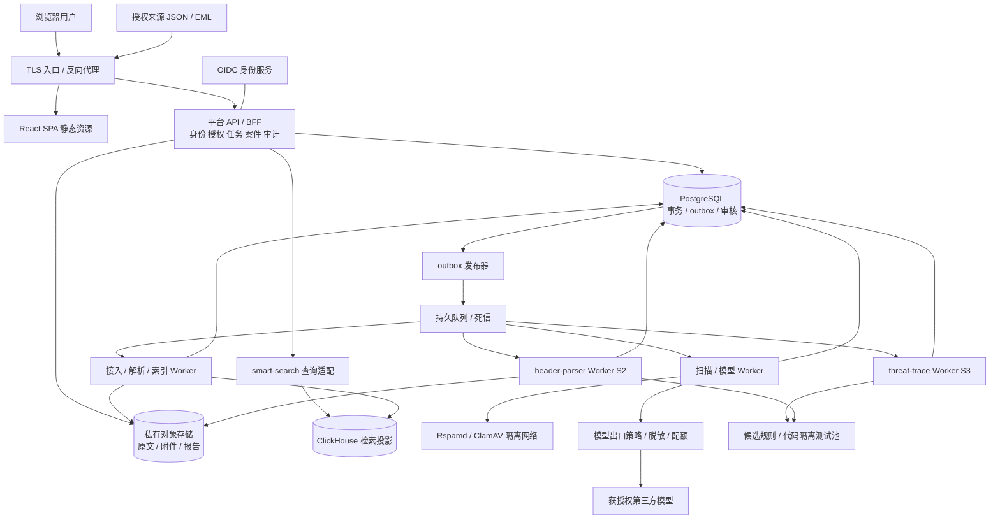

# MailSec Nexus 产品架构设计基线

> v1.1 草案 · 2026-10-22。服务/存储/网络边界设计，不是部署完成声明。需求来源：[综合需求分析](../../docs/综合需求分析.md)。

## 1. 架构决策与部署粒度

- **前后端分离**：React/TypeScript SPA 独立构建发布；FastAPI 平台 API/BFF 对外提供业务契约。生产可通过同一域名反代 `/` 与 `/api/`，分离开发不意味着必须跨域。
- **模块化优先**：平台控制面集中身份、授权、任务、案件、审核、策略、实验和审计；三个领域模块保留算法所有权和可独立测试/发布能力。API 可先合并部署，执行 Worker 按风险与资源拆开；不预设全量微服务。
- **开发顺序**：S1 smart-search + 产品底座 → S2 header-parser 增强 → S3 threat-trace → R1 集成上线门禁。平台不等到最后才做。
- **兼容独立模块**：smart-search 保留现有 JSON/EML 接口、本地队列、基础解析和轻量控制台，作为开发/独立交付形态；生产产品通过适配层接入，统一身份后不向浏览器暴露内部共享 token。
- **存储分工**：PostgreSQL 管事务，ClickHouse 管检索投影，对象存储管原文，消息队列管投递。不得把 ClickHouse 当审批事务库，也不得把队列当证据仓。

## 2. 目标逻辑拓扑

图中省略统一观测代理和结果事件；所有 Worker 回写自己领域的结果，通过平台任务接口/受限数据库权限更新作业状态，不取得其他领域表任意写权限。跨域关联以 ID 和版本化契约完成，不直接跨模块 JOIN 私有表。

## 3. 领域边界与降级

| 领域 | 所有权 | 输入/输出 | 故障时行为 |
| --- | --- | --- | --- |
| 平台控制面 | 身份映射、租户/项目、案件、任务、审批、配置/配额、审计 | 用户/服务操作 → 受控命令、投影汇总 | 无法认证/授权时 fail closed，不回退全局 token |
| smart-search | 基础解析/清洗、邮件索引、查询/NL/SOP、检测融合 | JSON/EML/增强解析 → 搜索/风险/证据 | 模型关停仍可结构化检索；索引故障保留接收状态 |
| header-parser | 方言解析、信任链、伪造/流向、解析器演进 | 有序头/可信配置 → 版本化增强结果 | 失败保留已有基础字段与错误状态，不阻断所有邮件 |
| threat-trace | 告警关联、行为模式、候选规则与回测执行 | 告警/标签/证据 → 候选算法及实验 | 规则实验失败不影响检索；旧批准版本继续可用 |
| 模型出口 | 双协议适配、授权/脱敏、预算、限流、失败处理 | 最小字段载荷 → 结构化输出/错误 | 明确 unavailable/unknown；禁止绕过代理直连 |
| 证据服务 | 原件访问、摘要、哈希、保全和生命周期 | 授权引用 → 受控读取/下载 | 证据缺失停止依赖完整原件的分析，显示原因 |

内部重用协议适配代码可抽包，但不把业务算法搬进 BFF。模型身份不拥有数据库、云存储或运维凭据。模型选择候选工具不决定授权。

## 4. 技术基线与明确不引入项

| 部分 | 基线 | 版本/实现边界 |
| --- | --- | --- |
| Web | React + TypeScript + Vite，Ant Design，路由/查询缓存，生成 API 类型 | 实施时锁依赖/Node 受支持版本，建立 build/typecheck/组件/E2E 流水线 |
| 后端 | Python 3.12、FastAPI/Pydantic；PostgreSQL 访问层及 Alembic 迁移 | 延续现有模块，不因产品化重写已验证算法 |
| 身份 | OIDC 授权码 + PKCE S256；企业 IdP 或独立身份服务 | BFF 保存会话，浏览器 HttpOnly/Secure/SameSite cookie；变更请求校验 CSRF |
| 元数据库 | PostgreSQL 受支持主版本 + 安全补丁版本 | 原题 14.18 的历史兼容与新生产部署分开；冻结前核验生命周期 |
| 搜索库 | 现有 ClickHouse 兼容版本经生产负载测试后锁定 | 既有物理 DDL 是独立版，不可直接认定为多租户最优结构 |
| 对象存储 | 私有 S3 兼容服务或企业现有对象服务 | 依据部署地域、许可证、加密/保全/策略兼容性形成 ADR，不默认某厂商完全兼容 |
| 队列 | RabbitMQ 持久消息 + publisher confirms + 手动 ACK | 高可用档用 quorum queue；任务状态留在 PG，不依赖队列展示历史 |
| 运维 | Docker 镜像；开发 Compose；CI/CD；OpenTelemetry 和指标/日志平台 | 高可用生产部署需独立故障域，编排平台按企业环境选定 |

不默认引入 Kafka、Elasticsearch、Redis、向量数据库、图数据库、GPU、服务网格。只有瓶颈/功能证据支持才通过 ADR 增加。图可视化不等于必须图数据库；“语义检索”与现有 NL2Query 是不同能力，不混为已有功能。

## 5. 多租户纵深隔离

### 5.1 双模式登录、两类身份与控制面

- OIDC 身份 `(issuer, subject)` 映射平台用户；验证签名、issuer、audience、过期、nonce/state/回调。ID Token 不直接当所有 API 的权限票据。
- 仅有 `user`（平台用户）与 `admin`（后台管理员）两类交互账号。统一登录页提供用户租户/管理员模式，模式绑定服务端认证事务；回调核验真实账号类型、用户租户归属及管理员MFA。模式参数不授予角色；身份不匹配拒绝登录，切模式须退出重新认证。
- BFF从用户会话解析租户/项目/资源归属；从管理员会话确定全平台最高操作及数据读写权，无需租户额外授权。管理员跨租户读取走显式后台路径，写入绑定目标租户/资源；不以普通用户请求中的空tenant_id代表全平台。内部上下文包含可信actor_type/actor_id/scope，外部X-Tenant-ID、role和来源ID不可授予权限。
- PostgreSQL 表包含 `tenant_id` 与必要的 `project_id`；唯一键/外键含租户，防跨租户引用。RLS 使用事务内上下文，连接池归还后不得残留租户状态。
- 业务角色不做 superuser/BYPASSRLS/表所有者；敏感表启用并按需要 FORCE RLS；迁移账号独立，禁止业务账号 TRUNCATE/改策略。平台用户的应用层租户/资源授权不能省略。管理员全平台权限通过受信管理服务与显式RLS管理策略/受限管理数据库身份实现，不能向用户或管理员浏览器发数据库superuser凭据；不能让客户端设置is_admin来绕过RLS。

### 5.2 ClickHouse 与对象

- 查、写、维护账号分离；普通用户的搜索/统计/导出/任务绑定租户/资源。管理员使用独立受信管理路径跨租户读取、操作各租户数据；全局读取需记录范围，写任务明确目标租户与对象。模型输出和外部参数不能覆盖授权作用域。
- 首版产品共享库隔离依赖受信服务授权及测试，不能称为物理隔离。租户专用受限身份/行策略可加纵深防护；若共享数据库身份可任意设租户参数，不应宣称其提供独立数据库强隔离。强隔离客户采用专库/专实例。
- 缓存键、游标、实验清单绑定身份类型/用户或管理员主体/查询范围/策略版本；对象路径仍绑定所属租户/项目；游标签名且短期有效，不携带明文敏感筛选。
- 对象默认私有，路径前缀不是 ACL；分别限制读写删除和枚举权限。高敏原文/附件走逐请求复核的代理下载（用户校验所属范围，管理员校验真实管理会话并记录目标租户），禁止以长期预签名地址绕过撤权；低敏报告如用短期签名链接须明确撤权延迟并限 TTL。
- 不向普通平台用户泄露其他租户哈希是否已存在；不跨租户内容去重或复用模型缓存。数据删除后仍需防缓存、索引和旧导出泄露。

## 6. 接入一致性与任务可靠性

目标产品链路（不声称现有独立模块已按此实现）：

1. 验证来源账号、大小/配额/格式，分配租户内事件/幂等标识。
2. 将原始载荷写入不可覆盖对象，验证哈希/写入回执。PG 事务写事件回执、任务、outbox 和幂等约束；成功后才返回 202。对象成功、事务失败产生的孤儿对象由对账回收，不形成可见成功事件。管理员代租户导入也必须明确目标租户，不产生无归属邮件。
3. outbox 发布器使用 publisher confirms 投递；确认丢失可重发。Worker 按 `tenant_id + operation_id + producer_version` 幂等执行，在持久保存处理结果后 ACK。
4. ClickHouse 是最终一致投影；写成功但 ACK 丢失可重复执行，借版本键和幂等投影合并。**不是端到端 exactly-once**，物理重复、逻辑重复、业务事件重复分别统计。
5. 每阶段持久 checkpoint、有限重试/退避；永久格式错误不无限重试。租户公平队列/并发限额防单租户挤占；超额 429/503 和 Retry-After，已接收数据不靠丢弃背压。
6. 死信可看原因/来源/attempt，由授权操作重放；“取消”停止未开始步骤，已完成不可逆步骤保留，最终状态说明。任务执行前重新检查租户禁用/外发授权/删除标记。
7. 索引延迟由 UI 显示 accepted/indexed 时间；定时按租户做接收数、终态数、在途数、死信数对账。队列 ACK 不等于业务完成。

独立版 SQLite WAL 与 spool 不强制立即替换；迁移时停新写/排空或受控双轨、对账、备份、切换，不能让新旧队列无协调消费同一来源。

## 7. 检索边界与容量设计

- 保留字段过滤和受控子串等当前语义；产品需另冻结中文/英文、大小写、短词、分词/短语、排序和总数语义。ClickHouse 文本索引依赖锁定版本、分词器和谓词，不承诺任意查询自动走索引。
- 根据代表性查询决定租户/时间分区与排序；新索引对旧数据的物化成本纳入升级。检验 EXPLAIN、扫描量、正确性、冷热 P95/P99，不能只展示单条 SQL 最快值。
- 列表只读摘要、稳定排序和游标；深分页/全量导出异步化；限定时间窗、单次扫描、内存、并发和租户预算；总体/近似数量必须标注语义。
- 系统级限流不能只靠单进程信号量；多实例并发由网关/队列或共享限额策略协调，ClickHouse 仍设账号资源上限。
- 对象字节增长、热索引、数据库 WAL、队列积压、备份/副本分开估算；按保留期与恢复目标预留容量，见交付路线图。

## 8. 三类安全执行环境

| 执行环境 | 用途 | 必需边界 |
| --- | --- | --- |
| 不可信文件解析/静态扫描 | EML/MIME 解析、Rspamd、ClamAV | 非 root、无宿主挂载/容器 socket、只读基底、临时目录、CPU/内存/PID/时间/展开量限额、最小网络；签名更新独立受控 |
| 候选代码/规则验证沙箱（S2/S3 P0） | LLM 生成解析代码/正则/规则的离线测试 | 独立隔离节点/VM 或经评估的强隔离执行器；无生产密钥/数据库、无默认出网、只读最小脱敏样本、一次性工作区、强制杀死/清理、产物扫描；只审核构建产物可进入发布 |
| 恶意附件动态沙箱（P2） | 执行附件采集行为 | 独立虚拟化故障域，快照恢复，隔离/仿真网络，禁止访问业务网和公网攻击，行为日志；容量/逃逸风险专项验收，不在 API/开发宿主运行 |

**ClamAV 容器不是动态沙箱；普通 Docker 隔离也不是可无条件信任的恶意代码边界。** 如基础设施不足，禁用候选代码执行/动态分析，而不是降低隔离级别后标成功。JSON 只有附件名/哈希没有字节时返回证据不足，禁止后台抓取任意 URL。

## 9. 模型、内容和审计安全

- 配置第三方端点需特权、审核、允许名单和 DNS/地址检查，阻断元数据地址/内网 SSRF；受控出网代理避免重定向与 DNS 重绑定绕过。敏感配置更新先合成健康探测，不批量发真实样本。
- 双协议适配经授权、脱敏、预算和超时后调用；不同租户凭据隔离、加密保存且只写不可回显；应用日志不打印 key、正文或完整提示词。
- 分析端把邮件视为证据而非指令；工具执行点重复校验 scope/参数/副作用，不允许任意 SQL、shell、文件路径、网络请求。
- 浏览器默认纯文本/转义展示；如增加 HTML 预览使用净化与独立 sandbox iframe、严格 CSP、阻断远程资源，附件下载不内联执行。
- 审计记录主体、租户、动作、对象、范围、策略/模型/算法版本、前后摘要、审批与结果。高风险配置/导出/规则发布在审计无法持久化时拒绝执行；普通运行日志与不可篡改审计归档分开。

### 9.1 最小威胁模型与验证映射

信任边界包括：来源/浏览器→入口、用户→平台、平台→存储/队列、Worker→不可信样本、模型出口→第三方、候选代码→沙箱。威胁模型随接口与部署变更更新，不能只在立项写一次。

| 资产/威胁 | 防护要求 | 验证证据 |
| --- | --- | --- |
| 邮件/案件：越租户或越项目IDOR | 可信作用域、逐对象授权、RLS/受限查询、对象ACL | 详情/统计/下载/任务/实验全链负测 |
| 凭据/会话：盗用、固定会话、CSRF | 成熟IdP、管理员MFA、会话轮换/撤销、CSRF校验、秘密轮换 | 登入登出/禁用/撤权/重放测试 |
| 解析/扫描服务：炸弹、ReDoS、资源耗尽 | 大小/展开/CPU/内存/超时限制、隔离执行、公平配额 | 恶意输入/最坏复杂度/多租户压力与杀进程恢复 |
| 模型/工具：提示注入、数据外泄、SSRF | 结构化计划、执行点授权、外发允许字段、出口管控 | 注入/越权/元数据地址/重定向负测，外发审计 |
| 浏览器：邮件HTML/附件XSS、敏感缓存 | 默认转义、受限预览、CSP、下载、租户切换清缓存 | 恶意主题/正文/附件名、后退/切换和脚本执行测试 |
| 证据/审计：篡改、删改、恢复复活 | 管理员业务读写留痕、哈希/版本/保全、不可静默篡改审计、删除台账 | 管理员授权读写正测、用户伪造管理员负测、恢复后可见性验证 |
| 供应链/候选代码：恶意依赖与沙箱逃逸 | 锁定依赖/SBOM/扫描、强隔离、无密钥与网络、审核构建 | 发布扫描/代码权限测试、隔离专项复核与产物溯源 |

每项记录风险等级、负责人、缓解措施与残余风险；S1试点前完成该范围威胁模型闭环，S2/S3新增执行面重新评审。架构隔离只能降低风险，不能以“已用容器”替代实际验证。

## 10. 独立版向产品版迁移

1. 冻结现有 JSON 34 列与 `/api/v2/mails`、`/api/v1/*`、`/v1/*` 的兼容测试；不把用户已有回执丢弃或改成另一种去重。
2. 新增平台身份、租户/项目、事件映射及新版本 Schema。单租户历史记录经管理员明确归属后迁移到 legacy 数据域；未归属隔离不可搜索。
3. 分离平台 `event_id` 与旧 `mail_id/event_id`，在映射表记录历史来源；同一 EML 内容可被多个事件引用，原 `Message-ID` 不是主键。
4. 按批回填租户/项目投影，读影子比较数量、字段、风险 unknown、幂等、哈希和查询；错误可回退旧只读服务。不要在34列旧表上无计划直接改造多租户。
5. 前端迁到平台身份会话和 API；独立模块不暴露给用户网络。旧 token 接口仅保留受限迁移窗口，停用前公告/观测调用者。
6. 完成对账和备份/恢复/撤权测试后切换；发布记录兼容窗口与回滚边界，旧视图/字段按弃用计划退出，不自动删除原始数据。

## 11. 设计依据

官方能力边界及版本说明见[技术依据](../../docs/product/技术依据与决策记录.md)。权限、队列、沙箱与部署设计是本项目的工程约束推导，仍需实现后的负向测试和故障演练来证明。
